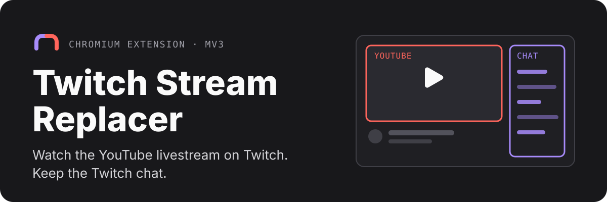
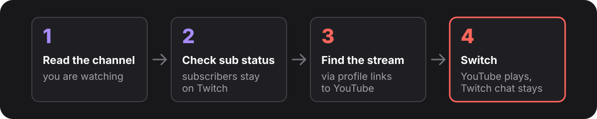

<p align="center">
  
</p>

<p align="center">
  <a href="#install">Install</a> ·
  <a href="#how-it-works">How it works</a> ·
  <a href="#good-to-know">Good to know</a> ·
  <a href="#permissions-and-data">Permissions</a> ·
  <a href="#development">Development</a>
</p>

Many streamers broadcast on Twitch and YouTube at the same time. This browser extension plays the YouTube livestream inside the Twitch page, so you can pick your video platform and still chat with the Twitch community.

- **Finds the YouTube stream for you.** It follows the YouTube links in the creator's Twitch profile and checks that a livestream is actually live.
- **One click to switch, one click back.** The YouTube player takes the video area; the native Twitch chat stays. Optional automatic switching is in the toolbar popup.
- **No double playback.** Twitch video and audio stay paused and muted while YouTube plays. Active channel subscribers always keep Twitch playback.
- **Quick controls.** Mouse-wheel volume over the player, a collapsible panel, and favorites that pre-check their YouTube status so switching is fast.
- **Your own YouTube session.** The regular YouTube player uses the browser profile's sign-in. The extension has no backend and no telemetry.

> [!NOTE]
> Under development. See [Project status](docs/PROJECT_STATUS.md) for what is implemented, how it was validated, and what is still open. The extension's controls currently use German labels.

## Install

Requires Chrome 120 or later, or a compatible Chromium browser (Edge, Brave). No build step, backend, or API key.

```sh
git clone https://github.com/Skriipt/twitch-stream-replacer.git
```

1. Open `chrome://extensions` (`edge://extensions`, `brave://extensions`) and enable **Developer mode**.
2. Select **Load unpacked** and choose the repository's **`extension/`** directory.
3. Sign in to YouTube in the same browser profile, then reload the Twitch page.

The [installation guide](docs/INSTALLATION.md) covers controls, favorites, updates, and cookie settings.

## How it works

<p align="center">
  
</p>

The subscription check repeats before every switch and every five seconds while the channel tab is visible. An unknown status keeps Twitch playing, and a new subscription during YouTube playback restores Twitch automatically. Details are in [subscription detection](docs/SUBSCRIBER_DETECTION.md).

<details>
<summary><strong>Which YouTube channels are found?</strong></summary>

<br>

- Direct YouTube links in the loaded Twitch profile and info panels: `/@name`, `/channel/UC…`, and legacy `/c/`, `/user/`, or bare custom-name links. If none are found, open the channel's **About / Info** section; links that load later are checked automatically.
- Up to five distinct linked channels are checked, and the extension verifies the channel ID and live player metadata before offering playback.
- If several channels are live, or one cannot be verified, Twitch keeps playing and you are asked to check YouTube directly.
- Chat links and recommendations are ignored. Short video links, link aggregators, and name-based search are not supported.
- STYLERZ and ColtHavok are always known as fallbacks.

</details>

## Good to know

- **Check again, not polling.** Discovery runs when you open a channel; use **Erneut prüfen** to look again after a broadcast starts. The only recurring request is the favorites check (at most every two minutes, only while Twitch is open).
- **Back to Twitch sticks.** **Zurück zu Twitch** keeps that channel on Twitch in the current tab, even with automatic switching on.
- **Premium is not guaranteed.** The extension cannot verify or enforce YouTube Premium benefits, and ad-free playback depends on cookie settings.
- **Not implemented yet:** manual timing adjustment to align video and chat.

## Permissions and data

| Access | Purpose |
| --- | --- |
| `www.twitch.tv` | Identify the channel and insert the controls and player. |
| `www.youtube.com` | Fetch channel and stream metadata. |
| `*.ttvnw.net`, `declarativeNetRequestWithHostAccess` | Temporarily block Twitch video requests in the switched tab. |
| `storage` | Save your settings, favorites, and a tab's deliberate return to Twitch locally. |
| `scripting` | Read the subscription state from the Twitch page's player data. |

No cookie permission, no credentials, no backend, no telemetry. The embedded player connects directly to YouTube.

## Development

Plain JavaScript and HTML with no runtime dependencies. Only `extension/` is loaded by the browser; reload it on the extensions page and refresh Twitch after editing.

```sh
npm ci
npx playwright install chromium   # Node.js 24 is used in CI
npm test                          # unit tests + headless Chromium tests
```

`npm run test:unit` runs without a browser, `npm run test:browser` runs only the Chromium tests, and `npm run check` checks the extension syntax. The tests use controlled Twitch and YouTube fixtures; they do not establish live YouTube playback, sign-in, or Premium behavior.

<details>
<summary><strong>Repository layout</strong></summary>

<br>

```text
extension/        Unpacked extension: manifest, scripts, popup, and icons
tests/unit/       Logic and subscription lifecycle tests (mocked APIs, JSDOM)
tests/browser/    Chromium integration and runtime regression tests
docs/             Installation, project status, and subscription design notes
assets/readme/    Hero and workflow graphics for this README
scripts/          Tools for regenerating extension icons
```

| File | Purpose |
| --- | --- |
| `extension/background.js` | Service worker, lookup cache, and per-tab network rules. |
| `extension/content.js` | Player replacement, menu, media controls, and channel navigation. |
| `extension/discovery.js` | Collect YouTube channel links from the Twitch profile. |
| `extension/resolver.js` | Read YouTube metadata and validate livestreams. |
| `extension/subscriber.js` | Read the subscription state from Twitch's player data. |
| `extension/youtube-volume.js` | Mouse-wheel volume inside the YouTube embed. |
| `extension/config.js` | Fallback mappings between Twitch and YouTube channels. |
| `extension/popup.html`, `popup.js` | Toolbar popup with the automatic switching toggle and favorites. |

</details>

---

<sub>An independent project with no affiliation with Twitch, YouTube, or the respective streamers.</sub>
